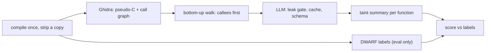

# TaintWalk

TaintWalk looks for memory-safety bugs in **stripped Linux binaries**: no source code, no symbols. Ghidra
decompiles each binary to pseudo-C and recovers its call graph. A language model then writes one structured
*taint summary* per function: where untrusted data enters, which dangerous operations it reaches, what guards
it, and a verdict. The walk goes **bottom-up**, so each function is analysed with its callees' summaries in
view. That is what lets it reason across function boundaries.

Every number is measured against ground truth the model never sees. Each test program is compiled once with
debug info, then a copy is stripped, so the two files share addresses exactly. The labels come from the debug
copy, and the model sees only the stripped one.

**Status:** research prototype. Every result below comes from a **local 9B model** (`ornith:9b` on an
8 GB laptop GPU). The cloud-model runs are built and tested offline but have not run, pending API credits.



More detail: [docs/ARCHITECTURE.md](docs/ARCHITECTURE.md).

## See it work

`taintwalk walk --explain` shows exactly what the walk put into one function's prompt. This is real output
from a Juliet binary (`tw-0015`, an OS command injection case):

```text
explain 0x1c23 FUN_00101c23   binary 866ee1a626c5
status        : ok   iteration 0
callees       : 0x1c61 ok
walk verdict  : vulnerable, os_command_injection
no context    : not vulnerable
--- callee block injected into the prompt ---
FUN_00101c61, called on line 4
  params: 0 pointer (undefined8)
  flows: param 0 -> sink:0
  sinks: sink:0 call_arg FUN_00101cfa, unguarded
  returns taint: no
  verdict: vulnerable, os_command_injection
--- end ---
```

On its own, the model cleared `FUN_00101c23`. Given its callee's summary (parameter 0 reaches an unguarded
command sink), it flagged it. **That flag is wrong:** by the ground-truth labels, both functions sit on one of
this program's *safe* paths. A summary describes the callee in isolation, so it cannot say "safe for what this
caller passes in", and the "vulnerable" verdict travelled upward anyway. Summaries flowing upward are the
whole point of the walk, and this is its main failure mode: in the coded error analysis, 15 of 20 false
positives on Juliet were a caller inheriting a callee's verdict like this. (Neither function is a scored path
root; the example shows the mechanism, not a scored result.)

## Results

### Juliet: 240 stripped binaries, 13 CWE classes, 636 scored functions

| Rung | What it is | Precision | Recall | Specificity |
|---|---|---|---|---|
| R1 | flawfinder on the pseudo-C | 0.482 | 0.617 | 0.598 |
| R2 | "calls an input function" rule | 0.552 | 0.713 | 0.649 |
| R3 | reachability of a flawfinder hit | 0.463 | 0.775 | 0.455 |
| R4 | LLM, one function, no context | 0.512 | 0.554 | 0.674 |
| R5 | **TaintWalk** (LLM + callee summaries) | 0.488 | 0.821 | 0.477 |

Callee context raises recall and lowers specificity, both significantly (exact McNemar, Holm-corrected).
TaintWalk is statistically indistinguishable from flawfinder plus reachability. The dumbest rule, "flag
anything that reads input" (R2), has the best balance, which says more about Juliet than about any detector.
Full tables: [docs/RESULTS.md](docs/RESULTS.md#main-table).

### Real code: 12 CVE fixes in mujs, md4c, giflib and Lua

Each CVE gives a pair: the function before its fix (vulnerable) and after (patched). A detector earns credit
only if it flags the first **and** clears the second. **No rung did that on any pair: 0/12 for all five.** The
LLM rungs flagged both sides or gave no answer. They never cleared a patched function.
[Details](docs/RESULTS.md#phase-9-real-code-generalization-held-out).

### Agentic mode: does letting the model choose what to read help?

Same frozen judge for every rung; only the evidence differs. 601 held-out Juliet functions.

| Rung | Evidence the judge sees | Recall | Specificity | Precision |
|---|---|---|---|---|
| R4 | none | 0.559 | 0.679 | 0.518 |
| A2 | reads the model chose | 0.661 | 0.623 | 0.521 |
| A1 | every direct callee's summary (scripted) | 0.744 | 0.551 | 0.503 |
| R5 | the whole bottom-up walk | 0.815 | 0.473 | 0.484 |

More evidence moves the operating point along one recall/specificity trade-off. It does not improve
discrimination. All six pre-registered tests reject, in opposite directions on vulnerable and safe functions.
The agent did not beat the scripted control, and it used about 3× its model time.
[Details](docs/RESULTS.md#phase-10-agentic-evidence-gathering-d-042).

## What this shows, and what it doesn't

- **A negative result, measured carefully.** On this model, interprocedural context trades false negatives
  for false positives, and nothing here separates vulnerable code from its patch.
- **Juliet is synthetic.** Its results did not transfer to real code. That is why the real-code pairs exist.
- **One small local model.** A stronger model may behave differently; the harness is built to test that cheaply.
- **-O0 binaries only.** Optimised code is untested.
- **Indirect calls are blind spots.** An unresolved function-pointer call leaves no call-graph edge; 12 of
  the 24 real-code roots have such calls below them.
- **Memorisation can't be ruled out** on public open-source code.

More: [docs/RESULTS.md, Limitations](docs/RESULTS.md#limitations) and the coded error analyses in
[docs/ERROR-ANALYSIS.md](docs/ERROR-ANALYSIS.md) and [docs/GAP-ANALYSIS.md](docs/GAP-ANALYSIS.md).

## How the results were kept honest

- **Leak gate.** Every prompt is scanned for ground-truth text (function names, CWE ids, file names) before any
  model call, with no off switch. 0 leaks across 11,029 prompts. The test suite also forbids the analysis code
  from importing ground truth.
- **Pre-registration.** Rungs, tests and scoring rules were committed to git before any number existed
  ([docs/PREREGISTRATION.md](docs/PREREGISTRATION.md)). Every deviation is logged there.
- **Deterministic replay.** Every model call is cached under a hash of model, parameters, prompt and schema.
  Every run replays offline byte for byte, and every score re-runs byte-identically.
- **Independent recounts.** Each headline table was recounted from labels and raw outputs with `jq`, with no
  scorer code involved.

## Setup

Tested on Ubuntu 26.04 under WSL2, with Python 3.14, gcc 15.2, JDK 21, Ghidra 12.1.4, and an RTX 4060 (8 GB).

**1. System packages**
```bash
sudo apt install -y build-essential binutils python3-venv python3-dev openjdk-21-jdk-headless jq unzip wget
```

**2. Ghidra 12.1.4** (the version is pinned; the Python bridge must match it)
```bash
mkdir -p ~/opt && cd ~/opt
URL=$(wget -qO- https://api.github.com/repos/NationalSecurityAgency/ghidra/releases/tags/Ghidra_12.1.4_build \
      | jq -r '.assets[].browser_download_url' | grep -E 'ghidra_12\.1\.4_PUBLIC_[0-9]+\.zip$')
wget -q --show-progress -O ghidra_12.1.4.zip "$URL"
echo "ddac49f903da9d5bac833e5cc79395098b9c33cfd3279be5f31bd00387d2d4db  ghidra_12.1.4.zip" | sha256sum -c -
unzip -q ghidra_12.1.4.zip -d ~/opt
echo 'export GHIDRA_INSTALL_DIR="$HOME/opt/ghidra_12.1.4_PUBLIC"' >> ~/.bashrc && source ~/.bashrc
```

**3. TaintWalk.** Keep the clone in the Linux filesystem, not under `/mnt/c`.
```bash
git clone https://github.com/piyushpatil/taintwalk.git && cd taintwalk
python3 -m venv .venv && source .venv/bin/activate
pip install -e '.[dev,eval]'
pip install --no-index -f "$GHIDRA_INSTALL_DIR/Ghidra/Features/PyGhidra/pypkg/dist" pyghidra
taintwalk doctor     # every row OK
pytest -q            # all hermetic tests pass; 39 corpus tests skip until the corpus is built
```
Install pyghidra from Ghidra's own bundle as shown, not from PyPI: it pins the exact JPype version Ghidra was
tested with.

**4. Local model** (needed only to make new model calls)
```bash
curl -fsSL https://ollama.com/install.sh | sh
ollama pull ornith:9b
```
The model's digest is pinned in `config/providers.yaml` (`a75697c14589`). If the tag now points at different
weights, TaintWalk refuses to run rather than silently mixing models. Pass `--provider ollama` explicitly: the
configured default is the cloud provider, which needs an API key.

## Reproducing the results

**Corpus** (about 10 minutes):
```bash
mkdir -p corpus/juliet/_dl
wget -O corpus/juliet/_dl/juliet-1.3.zip \
  https://samate.nist.gov/SARD/downloads/test-suites/2017-10-01-juliet-test-suite-for-c-cplusplus-v1-3.zip
echo "ada9d7e1c323d283446df3f55bdee0d00bda1fed786785fe98764d58688f38eb  corpus/juliet/_dl/juliet-1.3.zip" | sha256sum -c
unzip -q corpus/juliet/_dl/juliet-1.3.zip -d corpus/juliet/
taintwalk corpus build                  # 240 binaries, seeded selection
taintwalk corpus verify                 # proves every stripped copy matches its labelled twin
taintwalk extract --all --report        # Ghidra, about 8 minutes on 8 cores
taintwalk label runs/p2-extract --report
pytest -q                               # the corpus tests now run too
```
Unzip inside Linux, not on Windows, or the sources get CRLF line endings.

**Juliet walk and ablation** (4,105 model calls, about 12 hours on an RTX 4060):
```bash
taintwalk walk --all --programs runs/p2-extract/programs --run-dir runs/p8-local \
  --provider ollama --with-baseline --jobs 1
taintwalk eval --full --replay-check --jobs 4 --local runs/p8-local --results-md docs/RESULTS.md
```
Interrupted runs resume through the cache at no cost.

**Real-code pairs and agentic mode:** the procedures are pre-registered in
[docs/PREREGISTRATION.md](docs/PREREGISTRATION.md). The run scripts are `scripts/p9_live_run.sh`,
`scripts/p10_scored_run.sh` (which only runs at the `p10-freeze` tag) and `scripts/recount_p10.sh`.

**Caveat:** a different compiler version gives different binaries, so different hashes and fresh model calls.
Expect close but not identical numbers on another toolchain. The recorded toolchain is in
`corpus/manifest.json`.

## Repository layout

```
src/taintwalk/corpus/    build, label and verify the corpus; real-code pairs
src/taintwalk/extract/   Ghidra headless export to program.json
src/taintwalk/analysis/  prompts, summaries, call graph, bottom-up walk, agent mode
src/taintwalk/llm/       one call pipeline: leak gate, cache, providers, repair
src/taintwalk/eval/      joins, scoring, baselines, statistics, RESULTS.md
src/taintwalk/util/      the leak gate
scripts/                 Ghidra export script, run and recount scripts
tests/                   418 tests; those tagged `corpus` need the built corpus
docs/                    architecture, pre-registration, results, error analyses
```