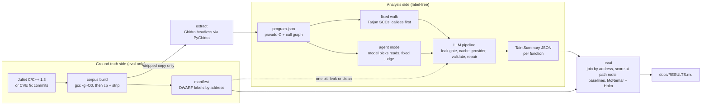

# Architecture

TaintWalk turns a stripped ELF binary into one structured taint summary per function. It walks the call graph
bottom-up, so callee summaries become context for their callers. The verdicts are scored against ground truth
that the analysis side never sees.

## The wall between the two sides

Everything left of the analysis box knows the answers: function names, DWARF line tables, which function is
`bad` and which is `good`. Nothing inside the analysis box may see any of it. If a label leaks into a prompt, the
result measures leakage, not detection. The wall is enforced three ways:

- **Structure:** the analysis and LLM code cannot import ground-truth modules or name ground-truth files
  (`tests/test_isolation.py`).
- **Runtime:** every prompt passes the leak gate (`src/taintwalk/util/leakcheck.py`) before any cache lookup or
  model call. The gate has no off switch. The only thing that crosses from the ground-truth side is one bit:
  clean or leaking.
- **Liveness:** `taintwalk selftest --leak` scans every prompt and plants canaries the gate must catch, so a gate
  that silently passed everything would fail the selftest.

## Stages

| Stage | What it does | Code | Output |
|---|---|---|---|
| Corpus | Selects 240 Juliet cases (13 CWE classes, 9 flow variants), compiles each once with `-g -O0 -fno-inline`, then copies and strips the copy, so both files have identical addresses | `src/taintwalk/corpus/select.py`, `src/taintwalk/corpus/build.py` | `corpus/manifest.json` |
| Ground truth | Labels each function from its DWARF compile unit (support, harness, bad, good) | `src/taintwalk/corpus/groundtruth.py` | labels in the manifest |
| Verify | Proves the stripped copy matches the labelled binary: `.text` address, size and SHA-256 compared three ways | `src/taintwalk/corpus/verify.py` | `taintwalk corpus verify` |
| Extract | Decompiles the stripped copy only. One JVM per binary; PLT stubs, thunks and CRT start-up are excluded structurally | `src/taintwalk/extract/ghidra_runner.py`, `scripts/ghidra_export.py`, `src/taintwalk/extract/schema.py` | `program.json` |
| Prompt | Redacts leaky string literals, collapses decompiler zero-fill noise, numbers the lines, appends callee context | `src/taintwalk/analysis/sanitize.py`, `src/taintwalk/analysis/prompts.py` | system + user text |
| Summary | The model fills a fixed schema, evidence first: sources, sinks, flows, then the verdict | `src/taintwalk/analysis/summary_schema.py`, `src/taintwalk/analysis/analyze_one.py` | one summary per function |
| Walk | Builds the call graph, condenses strongly connected components (Tarjan), and analyses callees before callers. Recursion iterates to a fixed point, capped at 3 rounds | `src/taintwalk/analysis/callgraph.py`, `src/taintwalk/analysis/walker.py`, `src/taintwalk/analysis/walk_all.py` | `summaries.json`, `walk.json` |
| Agent mode | Per root, the model picks one action at a time (list callees, read code, read a summary, finish) under hard caps. Then the same frozen judge gives the verdict | `src/taintwalk/analysis/agent.py`, `src/taintwalk/analysis/agent_tools.py` | `agent.json` + transcripts |
| Findings | Turns summaries into label-free findings; a failed analysis is "no summary", never "not vulnerable" | `src/taintwalk/analysis/findings.py` | `findings.json` |
| Score | Joins findings to labels by address and scores one function per Juliet path (the path root), with abstention as a third outcome | `src/taintwalk/eval/join.py`, `src/taintwalk/eval/metrics.py`, `src/taintwalk/eval/score.py` | `score.json` |
| Ablation | Five rungs on identical inputs: flawfinder, an input-call rule, reachability, the LLM without context, the full walk. Exact McNemar tests with Holm correction | `src/taintwalk/eval/baselines.py`, `src/taintwalk/eval/ablation.py`, `src/taintwalk/eval/pipeline.py` | `docs/RESULTS.md` |
| Real code | 12 vulnerable/patched function pairs from CVE fix commits, scored as pairs | `src/taintwalk/corpus/real.py`, `src/taintwalk/eval/real_score.py` | `corpus/real/manifest.json`, `docs/RESULTS.md` |
| Agent score | The four agent-study rungs (R4, A1, A2, R5), six pre-registered tests, cost as if run from an empty cache | `src/taintwalk/eval/agent_score.py` | `docs/RESULTS.md` |

## The LLM pipeline

Every model call goes through one function, `complete()` in `src/taintwalk/llm/base.py`. That function always
runs the same steps in the same order:

1. leak gate;
2. cache lookup;
3. size preflight;
4. send, retrying transport errors only;
5. parse and validate against the schema;
6. at most one repair, which shows the model only the validation errors, never its own rejected output;
7. cache store;
8. usage record.

The cache key (`src/taintwalk/llm/cache.py`) is a SHA-256 over the provider identity, generation parameters,
model digest, prompt and schema. So any change to any of them is a cache miss, and an unchanged re-run costs
zero tokens. Failures are cached too. As a result every run replays offline byte for byte, and every score
re-runs byte-identically.

Backends are swappable behind one interface (`src/taintwalk/llm/registry.py`): a local model through Ollama
(`src/taintwalk/llm/ollama_provider.py`, the one used for every reported number) and the Anthropic API
(`src/taintwalk/llm/anthropic_provider.py`, built and tested offline, not yet run).

## Invariants

- **I1:** no ground truth in any prompt (the wall above).
- **I2:** every run writes its prompts, responses and outputs, and re-scores without a model call.
- **I3:** everything is cached; an unchanged pipeline costs nothing to re-run.
- **I4:** findings join to labels by address, never by name or order.
- **I5:** library, PLT and CRT functions are never analysed or scored.
- **I6:** every baseline consumes the same `program.json` and is scored by the same rules.

## What lives where

- **Committed:** code, tests, config (`config/default.yaml`, `config/providers.yaml`), both manifests, the
  pre-registration (`docs/PREREGISTRATION.md`), the results (`docs/RESULTS.md`), and the coded error analyses
  (`docs/ERROR-ANALYSIS.md`, `docs/GAP-ANALYSIS.md`).
- **Regenerated, gitignored:** the Juliet download, compiled binaries, `program.json` files, run directories
  and the LLM cache, all under `runs/` and `corpus/`. Tests that need them are tagged `corpus` and skip when
  the corpus has not been built (`tests/conftest.py`).